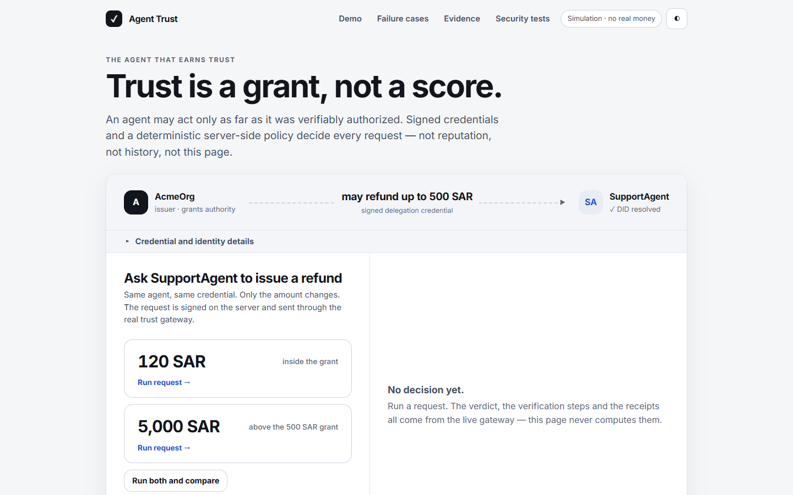
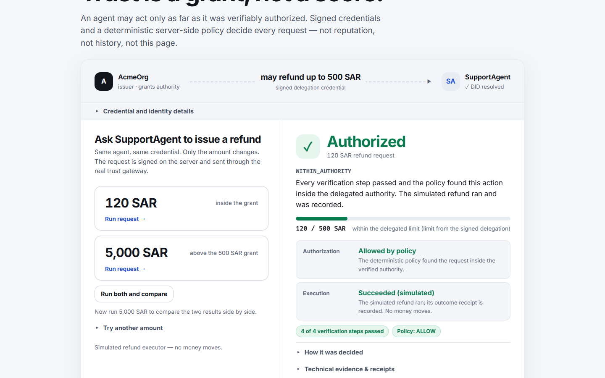
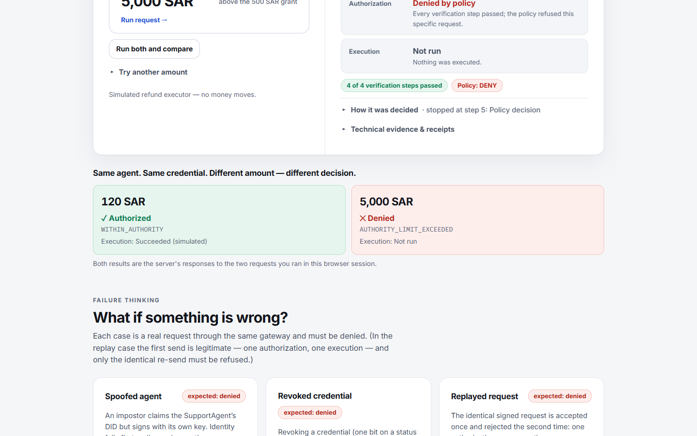
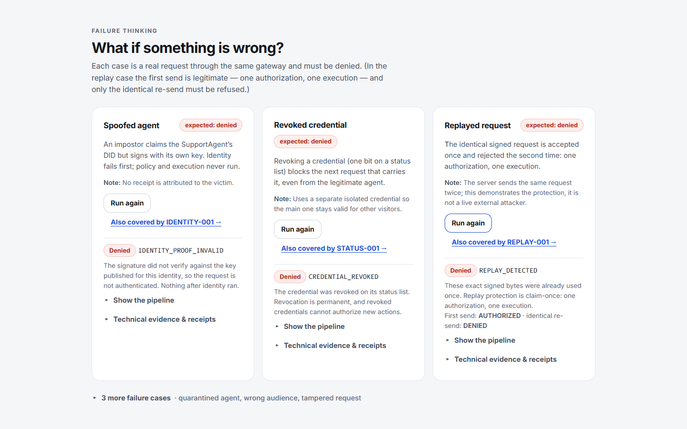
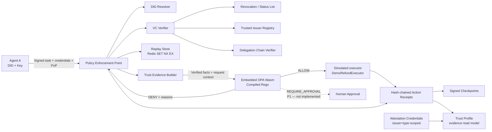

# Agent Trust

## Trust is a grant, not a score.

**A trust & authorization fabric for AI agents.** An agent may act only as far as it was *verifiably* authorized: a DID-proven identity, signed W3C credentials, scoped and revocable delegation, replay protection and a deterministic policy decide every request — never reputation, history or the UI. Audit-before-execution: a decision that reaches policy is written to a tamper-evident, hash-chained log *before* anything runs, and nothing executes without that receipt. Requests rejected earlier (a spoofed identity, a replay, a credential problem) or hit by an infrastructure failure are denied without a decision receipt — by design, so nobody can write entries under someone else's name.

> **Live demo (required deliverable):** https://agent-trust.onrender.com
> **Status (2026-10-28): live and verified.** The public service runs commit `f004ae8` (the merge of PR #3: the hardened attack-suite assurance, on top of the PR #1 security fixes and the PR #2 judge UI), deployed on 2026-10-28 as Render deploy `dep-dbh4jf8n74is73bjpeb0` and verified the same day by the author: `/api/health` reports `build.sha f004ae8`, `identityMode web`; `/api/demo/status` reports `replayStore redis`; `pnpm smoke:live` passed 45/45; a real-click browser check of the public site passed 15/15 and a separate check of the public `/attacks` page and claim wording passed 15/15. GitHub CI on `main` at `f004ae8` is green ([run 40750984910](https://github.com/abuzaro21/agent-trust/actions/runs/40750984910)). The free plan sleeps after about 15 minutes idle, so the first request can take about a minute. Details: [docs/deployment.md](docs/deployment.md). You can also run the demo locally with the quickstart below.
> **The refund executor is a simulation — no money moves.**
> **90-second video:** VIDEO_URL_PENDING — a walkthrough of the canonical run (120 SAR authorized, 5,000 SAR refused in full, spoof / revoked / replay stopped): real footage of the public demo (build `f004ae8`) plus labelled explanatory motion graphics, with **AI-generated narration (Chatterbox TTS)**. Record and disclosures: [docs/submission/video.md](docs/submission/video.md).

### Quickstart (local, ~3 minutes on first build)

```bash
git clone https://github.com/abuzaro21/agent-trust
cd agent-trust
docker compose -f docker-compose.demo.yml up --build
# → http://localhost:3000   (Redis-backed replay; no OPA install needed —
#   the policy engine runs from the committed, hash-pinned Wasm artifact)
```

Prerequisites: Docker with Compose v2, internet access to pull base images, and a free host port 3000 (edit the `ports:` line in `docker-compose.demo.yml` otherwise). No secrets are needed: the local demo runs in **fixture mode** (bundled `did:web` fixtures). Real `did:web` identities need the live overlay in [docs/deployment.md](docs/deployment.md).

### See it in four screenshots

<table>
  <tr>
    <td width="50%"><a href="docs/screenshots/01-hero-light.png"></a><br><sub><b>One stage.</b> AcmeOrg ▶ "may refund up to 500 SAR" ▶ SupportAgent (limit read from the backend's signed profile). The verdict stays empty until a request has really run.</sub></td>
    <td width="50%"><a href="docs/screenshots/02-allow-120-light.png"></a><br><sub><b>120 SAR → authorized.</b> Authorization (policy) and Execution (<i>simulated</i>) are two separate rows, straight from the backend <code>GatewayResult</code>.</sub></td>
  </tr>
  <tr>
    <td width="50%"><a href="docs/screenshots/04-comparison-light.png"></a><br><sub><b>5,000 SAR → denied, then compared.</b> <code>AUTHORITY_LIMIT_EXCEEDED</code>; the side-by-side view is built only from the two real responses.</sub></td>
    <td width="50%"><a href="docs/screenshots/06-failure-cases-light.png"></a><br><sub><b>Failure thinking.</b> Spoofed agent (<code>IDENTITY_PROOF_INVALID</code>), revoked credential, replay — each a real request through the same gateway. Suite evidence: <a href="docs/screenshots/17-security-tests.png">60/60 security scenarios</a>.</sub></td>
  </tr>
</table>

> **Where these images come from:** they were captured by clicking the real buttons against a **local** backend in fixture mode (`pnpm shots:live`) — nothing is mocked or composited. They are **not** captures of the public deployment (the public site was verified separately on 2026-10-28 — see above), with two exceptions: `08-evidence-light.png` and `17-security-tests.png` were refreshed on 2026-10-28 from the public deployment (build `f004ae8`, 1440×900 real browser) because the attack-suite wording they show changed; they reflect the shared live demo state (for example the audit-receipt count), not the local fixture state.

<details>
<summary>More screenshots (desktop, tablet, mobile; light and dark)</summary>

- **Desktop, light:** [5,000 SAR denied](docs/screenshots/03-deny-5000-light.png) · [how it was decided (8 gateway steps)](docs/screenshots/05-pipeline-light.png) · [grant · scope · revoke](docs/screenshots/07-grant-scope-revoke-light.png) · [evidence and audit history](docs/screenshots/08-evidence-light.png) · [security tests page](docs/screenshots/17-security-tests.png)
- **Desktop, dark:** [decision stage](docs/screenshots/09-hero-dark.png) · [comparison](docs/screenshots/10-comparison-dark.png)
- **Tablet:** [comparison](docs/screenshots/16-tablet-comparison-light.png)
- **Mobile (light):** [stage](docs/screenshots/11-mobile-hero-light.png) · [120 SAR authorized](docs/screenshots/12-mobile-allow-light.png) · [5,000 SAR denied](docs/screenshots/13-mobile-deny-light.png) · [comparison](docs/screenshots/14-mobile-comparison-light.png)
- **Mobile (dark):** [5,000 SAR denied](docs/screenshots/15-mobile-deny-dark.png)

</details>

### For judges

[Submission package](docs/submission/final-submission.md) (form data, thesis, status) · [Judge checklist](docs/submission/judge-checklist.md) (requirement → evidence) · [Two-year thesis](docs/submission/two-year-thesis.md) · [AI tools & decisions](docs/submission/ai-tools-and-decisions.md) · [Out of scope](docs/submission/out-of-scope.md) · [90-second video](docs/submission/video.md) (VIDEO_URL_PENDING; AI narration disclosed) · [Threat model](docs/threat-model.md)

**Same legitimate agent. Same identity. Same verified credential.**

| | Request | Result |
|---|---|---|
| | refund **120 SAR** | **ALLOW** → executed (simulated) → audit receipt |
| | refund **5000 SAR** | **DENY** `AUTHORITY_LIMIT_EXCEEDED` — exceeds the delegated cap of 500 SAR |
| | spoofed identity | **DENY** `IDENTITY_PROOF_INVALID` — signed with a foreign key |
| | revoked credential | **DENY** `CREDENTIAL_REVOKED` — current status kills authority |
| | replayed bytes | **DENY** `REPLAY_DETECTED` — one authorization, one execution |

The second row is the thesis: the agent was not "less trusted" — the *action*
left the scope of its authority. Deterministic policy, not reputation, decides.

**60/60 security scenarios pass** at image build time (see the
[Security Tests view](docs/screenshots/17-security-tests.png)): identity
spoofing, tampered proofs, audience confusion, delegation widening, revocation
bypass, replay, provider outages, DID-transport abuse — each judged on a typed expected outcome class and machine-checked invariants (for example that the executor and policy never ran on a denial, that a corrupted policy bundle never yields an engine, that untouched audit history verifies before it is tampered with); 49 of the 60 also require a specific reason code, and the other 11 record why they have none. A scenario fails if its verdict, reason code, any invariant, or its checker is missing. How this is enforced, what it does not prove, and the mutation evidence: [docs/security-assurance.md](docs/security-assurance.md).

### What this demo is — and is not

- **The executor is a simulation.** `DemoRefundExecutor` moves no money; the page says
  "Simulation · no real money" in the header and "Simulated refund executor — no money moves." on the decision stage.
- **The agents are server-owned fixtures.** The public API signs custom requests as the demo
  SupportAgent; it demonstrates the trust pipeline, it does not authenticate external callers.
  The *Replay* preset sends the identical signed request twice from the server; the *Revoked* preset revokes a separate isolated
  credential and submits it once, so the primary credential stays valid.
- **The demo clock is frozen** at `2026-09-15T12:00:00Z` (shown by `GET /api/demo/status`), so
  results and receipt timestamps are deterministic; real wall-clock expiry is covered by the tests.
- **State is process-local.** Audit receipts, status lists and profile evidence live in memory and
  reset on restart (single replica); only replay claims are externalized to Redis.
- **The gateway accepts a single delegation link.** Multi-hop chains are verified and attenuated
  in `packages/delegation` (tested directly) but are not presentable through the gateway in P0.

**Architecture in one line:** Identity → Claims → Verification → Authority → Policy → Provenance (full diagram in [docs/architecture.md](docs/architecture.md)).

## The Problem

AI agents are increasingly allowed to take real actions — refunds, payments, data access — with nothing but an API key and a prompt. Nobody can answer, before execution, in a way that is cryptographically verifiable:

> *Should this agent be allowed to do this action, for this principal, on this resource, right now — and can we prove why?*

A reputation number cannot answer that question. A high score does not create authority, and a low score does not revoke it. This project replaces the "trust score" with a **trust fabric** that proves each layer independently:

```text
Agent DID
   ↓
Signed proof-of-possession
   ↓
W3C Verifiable Credentials
   ↓
Delegation / Capability chain
   ↓
Credential + Revocation Verification
   ↓
Context + Provenance + Attestations
   ↓
Embedded Rego Policy Engine (OPA Wasm)
   ↓
ALLOW / DENY  (REQUIRE_APPROVAL is a P1 contract — never returned by the P0 policy)
   ↓
Simulated enterprise action (DemoRefundExecutor)
   ↓
Tamper-evident Action Receipt
```

## What the Fabric Proves

| Question | Mechanism |
|---|---|
| Who is the agent? | W3C DID (`did:web` in P0, `did:key` for test fixtures), proof-of-possession on every request |
| Who granted its authority? | W3C Verifiable Credentials 2.0 (JWS/ES256) from issuers listed in a **Trusted Issuer Registry** |
| What are the limits? | Scoped actions/resources, amount & time caps, strict **delegation attenuation** (`Authority(child) ⊆ Authority(parent)`) |
| Is it still valid? | W3C Bitstring Status List revocation + emergency quarantine |
| Is *this* action acceptable *now*? | Rego policies compiled to **OPA Wasm, embedded in the service process** — deterministic `ALLOW` / `DENY` with reason codes (`REQUIRE_APPROVAL` exists in the schema but is not produced by the P0 policy) |
| What actually happened? | Tamper-evident, hash-chained **Action Receipts** with signed checkpoints |

## The Sentence That Leads This Project

> **Identity tells us who the agent is. Credentials tell us what others claim about it. Delegation tells us what it is allowed to do. Reputation provides evidence about past behavior. Policy decides whether this specific action is acceptable now.**
>
> No layer substitutes for another.

And the invariant that makes the model coherent:

> **Reputation can strengthen or weaken trust, but it can never manufacture missing authority.**
>
> - An agent with 10,000 successful actions and no `refund:create` credential → **DENY**.
> - A brand-new agent with a valid low-risk delegation → can be **ALLOW**.
> - A high-reputation agent whose credential was revoked → **DENY**.

## Security Stance

- **The LLM never decides its own permissions.** An agent runtime may *propose* a tool call, but every request passes through an independent, deterministic enforcement point. Prompt injection cannot alter a Verifiable Credential or a Rego policy.
- **Compromised keys are assumed possible.** No cryptography detects an attacker who holds the *valid* private key — so the design limits the blast radius instead: narrow scopes, per-credential amount caps, audience binding, bounded credential & proof lifetimes, revocation, and an emergency quarantine switch. (Not in P0: `limits.perDay` is accepted by the credential schema but **not enforced**, and human-in-the-loop approval is a P1 target — the P0 policy never returns `REQUIRE_APPROVAL`.)
- **Fail closed.** Missing/invalid policy bundle, policy-engine failure, unavailable replay store on a write action, signature-verifier errors, and failure to persist the *decision* receipt — all deny, and the protected action never runs. (If the *outcome* receipt cannot be written after a successful execution, the result is `EXECUTION_UNCERTAIN`: the effect ran, the audit trail is incomplete, and the side effect is not retried.) There is no permissive fallback. One honest nuance: when the policy *engine itself* throws, the denial stands but **no decision receipt is written** (the receipt schema requires a real policy hash, which an engine that failed cannot supply).

## Demo Scenario

Two fictional organizations:

```text
Acme Retail                          PayCo
  CustomerSupportAgent  ──refund──▶  PaymentAgent
```

Acme issues its support agent a delegation credential: `refund:create`, `merchant:acme`, **max 500 SAR**, bounded expiry. PayCo's PaymentAgent has **never seen Acme's agent before** — it knows only trusted issuers and policy. Trust is portable across the organizational boundary.

The failure demo is the point:

```text
1) Valid identity + 120 SAR refund          → ALLOW
2) Same identity + 5,000 SAR refund         → DENY  AUTHORITY_LIMIT_EXCEEDED
3) Spoofed identity / wrong private key     → DENY  IDENTITY_PROOF_INVALID
4) Legit agent, credential revoked          → DENY  CREDENTIAL_REVOKED
5) Replay of captured signed bytes          → DENY  REPLAY_DETECTED
```

> **The agent is trusted — but not for this action.**

## Architecture at a Glance



Full details: [docs/architecture.md](docs/architecture.md) · [threat model](docs/threat-model.md) · [credential model](docs/credential-model.md) · [trust model](docs/trust-model.md)

## Repository Layout

```text
agent-trust/
├── apps/
│   └── web/                  # Next.js demo & operations UI — the ONLY running app; composes the packages below in-process
├── packages/                 # implemented, tested libraries (the real trust fabric)
│   ├── crypto/               # Signer abstraction (local ES256 signer), RFC 8785 canonical JSON, PoP
│   ├── did/                  # DidResolver seam + did:web (hardened) and did:key P-256
│   ├── vc/                   # W3C VC issue/verify (JWS, ES256)
│   ├── delegation/           # Attenuation-verified delegation chains (tested directly)
│   ├── status/               # Bitstring Status List + quarantine
│   ├── replay/               # Atomic claim-once replay protection (memory + Redis)
│   ├── policy/               # Embedded OPA Wasm engine (hash-pinned artifact)
│   ├── audit/                # Hash-chained Action Receipts + signed checkpoints
│   ├── gateway/              # The Trust Gateway — one authorized path + simulated executor
│   ├── trust-profile/        # Evidence-based trust profiles
│   ├── attacks/              # 60-scenario adversarial suite
│   └── schemas/              # JSON schemas for all contracts
├── policies/                 # Rego — policies are code, versioned & hashed
├── artifacts/policy/         # committed, hash-pinned policy.wasm + manifest.json
├── deploy/ · docker-compose*.yml · apps/web/Dockerfile   # demo deployment
├── scripts/ · tests/         # demo/setup scripts; tests/* are empty placeholders (tests live in each package)
└── docs/                     # architecture, threat model, ADRs, submission package
```

**Target architecture, not built in P0** (empty `.gitkeep` placeholders only): `apps/trust-gateway`
(standalone Fastify gateway), `apps/credential-service`, `apps/agent-alpha`, `apps/agent-beta`,
`packages/policy-engine`, `packages/sdk`, `packages/testkit`, `infra/terraform`; plus `did:webvh`,
Cloud KMS/HSM signing, PostgreSQL persistence and human-in-the-loop approvals. In P0 the gateway runs
in-process inside `apps/web` route handlers.

## Status & Roadmap

**Architecture and features frozen for submission; post-audit repairs applied.** Release-verification results (counts are from runs on the release code; see [docs/submission/final-submission.md](docs/submission/final-submission.md) for the exact record and who ran what): 662 tests in the default `pnpm test` run (577 package tests + the 85 `apps/web` tests that `pnpm test:frontend` also runs alone; with OPA on PATH all pass, and the native-parity cases skip without it), a 78-check browser-automation run (`pnpm ui:check`), 5 Redis integration tests, 13 native Rego tests, 60/60 attack-suite scenarios. GitHub CI on `main` at `f004ae8` runs typecheck, Rego checks, the policy-artifact integrity check, the tests, the web tests and production build, the attack suite and the Redis integration tests, and is green. The public Render service runs `f004ae8` (deploy `dep-dbh4jf8n74is73bjpeb0`, 2026-10-28; `smoke:live` 45/45; see [docs/deployment.md](docs/deployment.md)). Outstanding: the optional recorded walkthrough, and a final re-verification of the public URL immediately before submission.

| Phase | Scope |
|---|---|
| **P0 — frozen** | `did:web` + `did:key` fixtures, real JWS/VC signing & verification, scoped delegation + attenuation, trusted issuers + real revocation, atomic Redis replay protection with fail-closed writes, Rego → embedded OPA Wasm with reason codes, tamper-evident provenance, two demo agents, attack suite, public live demo |
| **P1 — not implemented** | `did:webvh` resolver adapter, Cloud KMS/HSM signer, human-in-the-loop approvals (`REQUIRE_APPROVAL`), `perDay` quota enforcement, multi-hop delegation through the gateway, RFC 8693 token-exchange subset, one A2A adapter |
| **P2 — post-competition** | SPIFFE/SPIRE deployment, full MCP/A2A interop, multi-tenant control plane, selective disclosure |

Build order and week-by-week plan: [docs/roadmap.md](docs/roadmap.md).

## Development

Requires Node 22+ (24 recommended). pnpm is provided via corepack:

```bash
corepack enable
pnpm install
pnpm typecheck          # strict TS across the workspace
pnpm test               # vitest unit + property suite (no services needed; run `pnpm setup:opa`
                        # first or the 10 native-vs-Wasm parity cases are skipped)
pnpm test:integration   # Redis-backed replay tests (needs TEST_REDIS_URL)
docker compose up -d redis   # one-command dev Redis (port 6380 — 6379 is
                             # inside a Windows excluded-port range on some
                             # machines; CI uses 6379)
TEST_REDIS_URL=redis://127.0.0.1:6380 pnpm test:integration

pnpm demo:e2e           # cross-agent gateway demonstration (all real components)
pnpm demo:profile       # evidence-based Trust Profiles — attestations, history, integrity
pnpm demo:attacks       # attack suite: 60 deterministic scenarios (typed outcome + machine-checked invariants each)
pnpm test:attacks       # same suite as a CI gate (exits non-zero on any FAIL)

# Demo dashboard (Next.js)
pnpm dev                # http://localhost:3000 — trust console + /attacks security tests
pnpm test:frontend      # API adapter integration + presentation tests
pnpm ui:check           # browser checks of the running UI (UI_URL=http://localhost:3000 — layout, keyboard, states)
pnpm ui:shots           # screenshots + horizontal-overflow report at 1920/1440/768/390 px
pnpm shots:live         # regenerate docs/screenshots from the real UI
pnpm build:web          # production build check
pnpm demo:did:init      # one-time live identity setup → did:web docs + gitignored local keys
pnpm demo:did:resolve did:web:example.com:agents:support   # real HTTPS resolution + diagnostics
DEMO_DID_DOMAIN=example.com pnpm demo:e2e:web              # live did:web mode (deployment-gated)

# Policy pipeline (requires the pinned OPA v1.20.2 on PATH, or tools/bin):
pnpm policy:fmt && pnpm policy:check && pnpm policy:test
pnpm build:policy       # → artifacts/policy/policy.wasm + manifest.json (hash-pinned)
```

Implemented packages (Phases 1–6 — identity, credentials, delegation, status, replay, policy, gateway):

| Package | Contents |
|---|---|
| `@agent-trust/schemas` | JSON Schema contracts (draft 2020-12), TS types, closed reason-code enum, ajv validator |
| `@agent-trust/crypto` | Frozen `Signer` interface, ES256 `LocalSigner`, RFC 8785 canonical JSON, DPoP-style proof-of-possession |
| `@agent-trust/did` | `DidResolver` seam (ADR-0001), `did:key` P-256, production `did:web` resolver (ADR-0004): strict parser, HTTPS-only SSRF-pinned transport, exact document-id binding, P-256 key profile, bounded cache with rotation-aware freshness, method registry |
| `@agent-trust/vc` | Compact-JWS W3C VC 2.0 issuance/verification — 11-stage pipeline. Quarantine kill switch on verified identities. |
| `@agent-trust/delegation` | `Authority(child) ⊆ Authority(parent)` attenuator + chain walker with cycle detection, property-tested |
| `@agent-trust/status` | W3C Bitstring Status List (revocation permanent, suspension reversible), signed status-list credentials, agent quarantine — fail-closed |
| `@agent-trust/replay` | Atomic CLAIM-ONCE replay protection (ADR-0003): in-memory + Redis `SET NX PX`, post-crypto claim ordering, proof-derived TTL |
| `@agent-trust/policy` | Embedded OPA Wasm engine (ADR-0002): hash-pinned artifact, `VerifiedFacts`-only input, deterministic denial precedence |
| `@agent-trust/audit` | Hash-chained Action Receipts (domain-separated SHA-256, RFC 8785 bodies), atomic append, signed checkpoints, tamper/truncation/rewrite detection |
| `@agent-trust/gateway` | **The Trust Gateway** — composes every layer into one authorized path: PoP → replay → VC/status → delegation chain → VerifiedFacts → policy → decision receipt → idempotent executor → outcome receipt. Receipts only for authenticated actors; audit-before-side-effect; executor unreachable without gateway authorization. |
| `@agent-trust/trust-profile` | **Trust Profiles (read model)** — contextual, evidence-based answers to "what VERIFIED evidence exists for this agent": resolved identity, active authority with evidence digests, issuer+type-scoped attestations, and aggregated history from the VERIFIED audit chain + signed checkpoint (history fails closed independently). `AgentAttestationCredential` passes the FULL VC pipeline; attestations are EVIDENCE, never authority. The profile schema structurally forbids score fields — no trust/reputation number exists, and the profile never bypasses policy. |
| `@agent-trust/attacks` | **Attack suite** (`pnpm demo:attacks`) — 60 deterministic scenarios across identity/credential/authority/status/replay/policy/audit/attestation/did:web/infrastructure; each declares a typed expected outcome class and is judged on machine-checked invariants (a missing checker, verdict or invariant fails), 49 also require a specific reason code (11 documented exceptions); machine-readable `artifacts/attacks/attack-report.{json,md}`; see [docs/security-assurance.md](docs/security-assurance.md) |

| `apps/web` | **Demo dashboard** (Next.js, `pnpm dev`) — trust console (profile, presets, pipeline, decision, audit, evidence) + `/attacks` suite view. A pure read model: every decision comes from the real gateway server-side; no trust logic or scores in the browser. |

## Deployment (demo)

The dashboard ships as a self-contained multi-stage image. Everything it needs to make
REAL decisions — the hash-pinned OPA policy artifact and the deterministic 60-scenario
attack report — is baked in at build time; the container runs the same gateway pipeline
the tests cover.

```bash
# Build from the repository root (Dockerfile lives in apps/web):
docker build -t agent-trust-demo -f apps/web/Dockerfile .

# Run with the in-memory demo replay store:
docker run -p 3000:3000 agent-trust-demo

# Run with Redis-backed atomic replay protection (recommended demo mode):
docker compose -f docker-compose.demo.yml up --build
```

Then open http://localhost:3000 (dashboard) and http://localhost:3000/attacks (suite
view). `GET /api/demo/status` reports which replay backend is live (`redis` vs
`in-memory`), the identity mode (`web` vs `fixture`), the live DIDs, and the
build SHA. `GET /api/health` is the lightweight platform health check.

**Live identity mode (public deployment)** adds real `did:web` identities:
org/support/refund resolve over public HTTPS via the hardened Step 12 resolver
(host allowlist, pinned DNS, exact-document binding, bounded cache; startup
fails if resolution or Redis fail — no silent fallbacks). The full operational
contract — environment variables, secret custody, state/restart model,
single-replica requirement, public identities hosted at
`did:web:abuzaro21.github.io:agents:{org,support,refund}`, provider blocker —
is in **[docs/deployment.md](docs/deployment.md)**. After any configuration
change, verify with the outside-in regression gate:

```bash
DEMO_PUBLIC_URL=https://<host> pnpm smoke:live   # 45 checks: public DIDs,
                                                  # judge scenarios, leak scans
```

No private keys, signer material, or Redis credentials are meant to leave the server
process: the browser receives sanitized DTOs only, response-shape tests
enforce that, and `smoke:live` scans the JSON responses it fetches, the HTML shell and up to 12 JS bundles
(a best-effort scan, not proof of absence).

## Architecture: the authorized path

```text
SupportAgent (proposes)          the agent/LLM is NOT the authorization boundary
      │  signed task (PoP bound to task content)
      ▼
Trust Gateway  ──────────────  VERIFICATION BOUNDARY
      ├─ 1 request schema (fail closed)
      ├─ 2 identity / PoP / DID / htu / time
      ├─ 3 replay claim (Redis SET NX PX, post-crypto)
      ├─ 4 credentials: selection → verification → status → quarantine
      ├─ 5 delegation chain → effective attenuated authority
      ├─ 6 VerifiedFacts (centralized builder)
      ├─ 7 policy — OPA Wasm          POLICY BOUNDARY
      ├─ 8 decision receipt           PROVENANCE BOUNDARY (audit-before-side-effect)
      ├─ 9 DENY → stop, executor never called
      ▼
Action Executor  ────────────  SIDE-EFFECT BOUNDARY (idempotent by taskId)
      ▼
execution-outcome receipt (separate chained event)
```

The defining demonstration: the same fully-authenticated legitimate agent, same valid credentials — **120 SAR → ALLOW, 5000 SAR → DENY `AUTHORITY_LIMIT_EXCEEDED`**. Run it yourself:

```bash
corepack pnpm demo:e2e                                   # in-memory replay store (labeled)
TEST_REDIS_URL=redis://127.0.0.1:6380 corepack pnpm demo:e2e   # real Redis SET NX PX
```

The project's own rule applies: **no UI before cross-agent E2E works** — a single `pnpm demo:e2e` must print that Agent A was accepted or rejected for the right reasons before any dashboard exists.

## Documentation

- [Architecture](docs/architecture.md) — the planes, verification pipeline, and delivery decisions
- [Threat model](docs/threat-model.md) — attack suite, fail-closed matrix
- [Credential model](docs/credential-model.md) — VC types, delegation attenuation rules
- [Trust model](docs/trust-model.md) — trust profiles, reputation-as-evidence, decision objects
- [Roadmap](docs/roadmap.md) — phases, build order, definition of done
- [ADRs](docs/adr/) — frozen architecture decisions ([ADR-0004: did:web live identity plane](docs/adr/0004-did-web-live-identity.md))
- [Deployment (Step 16)](docs/deployment.md) — env contract, state model, public identities
- [Submission package](docs/submission/final-submission.md) — judge summary, 90-s script, two-year thesis, out-of-scope, checklist
- [Security policy](SECURITY.md) · [Contributing](CONTRIBUTING.md)

## License

[MIT](LICENSE) © abuzaro21 and contributors
